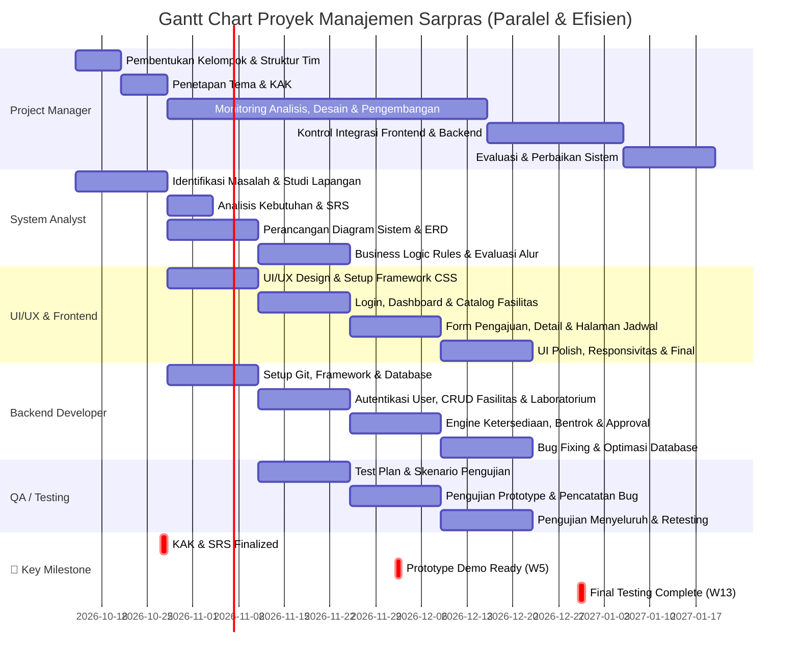

# 📊 Gantt Chart Proyek Manajemen Fasilitas & Laboratorium - 13 Minggu (Paralel & Efisien)

**Timeline:** Minggu 1 - Minggu 13  
**Strategi:** Parallel Execution dengan Dependency Management  
**Last Updated:** 2026-10-10

---

## 📈 Visualisasi Gantt Chart (Paralel & Efisien)



---

## 📋 Penjelasan Strategi Paralel & Efisien

### 🔑 Keunggulan Pendekatan Paralel:

#### ✅ **1. Fase 1: Foundation (W1-W2)**
```
Aktivitas Sequential (HARUS berurutan):
├─ W1: Pembentukan Kelompok → Struktur Tim Clear
├─ W2: Penetapan Tema → KAK Matang
└─ Hasil: Semua orang tahu apa yang dikerjakan
```
- **Durasi:** 2 minggu
- **Blokir oleh:** Tidak ada (fase inisiasi)
- **Keluaran:** Tim siap, KAK/Tema terdefinisi

---

#### 🚀 **2. Fase 2: Analisis & Desain Paralel (W3-W5)**
```
Aktivitas Paralel (Bisa dimulai bersamaan):

ANALYST PATH                          DEVELOPMENT PATH
├─ W3-W4: SRS & Diagram             ├─ W3-W4: UI/UX Design
├─ W4-W5: Database & ERD            ├─ W4-W5: Framework Setup
└─ W5-W6: Business Rules            └─ W5-W6: Database Config
        ↓                                  ↓
     MERGE POINT: Hasil Analisis ← Shared Knowledge → Framework Ready
```
- **Analyst:** Perancangan Diagram & ERD (14 hari)
- **Frontend:** UI/UX Design & Framework Setup (14 hari)
- **Backend:** Git Setup & Database Config (14 hari)
- **Sinkronisasi:** Koordinasi Mid-W5 untuk alignment

**Benefit:** 
- Parallel work mengurangi idle time
- Designer & Developer bisa mulai berdasarkan requirement awal
- Analyst tetap detail tanpa menunggu tim lain

---

#### 🔧 **3. Fase 3: Implementasi Paralel (W5-W8)**
```
ANALYST:                Backend:                    Frontend:
├─ Business Rules ─┐   ├─ Auth ─┐                 ├─ Pages ─┐
└─ (Ready W6-W7)   │   ├─ CRUD  ├─→ Integration ←├─ UI ────┤
                   │   └─ Engine┘                 └─ Demo ──┘
                   └──────→ W8: PROTOTYPE READY
```
- **Backend & Frontend** bekerja paralel dengan API Contract yang jelas
- **Testing** mulai W6 dengan Test Plan
- **Analyst** mulai Business Logic Rules untuk Engine

**Deliverable W8:**
- ✅ Prototype Demo (Frontend + Backend terintegrasi)
- ✅ API Working
- ✅ Initial Test Coverage

---

#### 🧪 **4. Fase 4: Testing & Refinement (W9-W13)**
```
PARALEL TRACK:

Testing Track                    Development Track
├─ W9: Bug Reporting      ├─ W9-W10: Responsivitas UI
├─ W10-W12: Full Testing  ├─ W10-W11: Admin Features
└─ W13: Verification      └─ W12-W13: Final Polish
        ↓                          ↓
        └─────→ Quality Gate ←─────┘
               W13: Production Ready
```

- **Parallel Testing & Development** untuk fast-track fixes
- **QA tidak terserah Development** (independent team)
- **Verification cycle** pada W13

---

## 📊 **Timeline Breakdown Per Fase**

### Fase 1: Foundation (W1-W2) - 2 minggu
| Role | Task | W1 | W2 | Deliverable |
|------|------|----|----|-------------|
| PM | Pembentukan Tim | ✅ | | Struktur Organisasi |
| PM | KAK Penetapan | | ✅ | KAK Document |
| **Status** | **Sequential** | **HARUS** | **Urut** | **Blocker utama** |

---

### Fase 2: Design & Analysis (W3-W5) - 3 minggu
| Role | Week | Task | Status | Output |
|------|------|------|--------|--------|
| **Analyst** | W3-W4 | SRS + Diagram + ERD | ⏳ Planned | Architecture Doc |
| **Frontend** | W3-W4 | UI/UX + Wireframe | ⏳ Planned | Design System |
| **Backend** | W3-W4 | Tech Stack + DB Config | ⏳ Planned | Infrastructure |
| **Analyst** | W5-W6 | Business Logic | ⏳ Planned | Rules Document |

**Sinkronisasi Point:** 
- Mid-W3 Design Review → Backend & Frontend align
- End-W4 API Contract Review → Database Schema matches endpoints
- Mid-W5 Validation Rules Review → Engine requirements clear

---

### Fase 3: Implementation (W6-W8) - 3 minggu
| Role | Week | Task | Status | Milestone |
|------|------|------|--------|-----------|
| **Backend** | W6-W7 | Auth + CRUD | ⏳ Planned | API v1 Ready |
| **Frontend** | W6-W7 | Pages Build | ⏳ Planned | UI Pages Ready |
| **Testing** | W6-W7 | Test Planning | ⏳ Planned | Test Cases Ready |
| **Integration** | W8 | Prototype Merge | ⏳ Planned | **Demo Ready** 🎯 |

**Sync Checkpoint W8:**
- ✅ Backend APIs 100% working
- ✅ Frontend Pages 100% integrated
- ✅ Testing on Demo completed
- ✅ Prototype Ready for Evaluation

---

### Fase 4: Optimization (W9-W13) - 5 minggu
| Week | PM | Analyst | Backend | Frontend | Testing |
|------|----|---------|---------|---------:|---------|
| **W9** | Monitor | Evaluate Sys | Start Polish | Responsivitas | Bug Log |
| **W10** | Coordinate | Finalize Doc | Engine Dev | Continue UI | Test Full |
| **W11** | Support | Sign-off | Admin Features | Admin Pages | Report |
| **W12** | Track | Final Review | Optimasi DB | Final Polish | Comprehensive |
| **W13** | Checkpoint | Docs Ready | Production | Deployment | Verification |

---

## 🎯 **Key Milestones & Dependencies**

```
CRITICAL PATH:

W1: Team ──→ W2: KAK ──→ W3-5: Design & Config ──→ W6-8: Code & Integration
                                    │                      │
                            (Analyst can work          (Dev fully paralel)
                             independently)
                                    │
                         W9-13: Test & Polish ←─────────────────┘
```

### Blocking Dependencies:
1. **KAK must be done before W3** (blocker for all)
2. **Design finalized before W6** (blocker for Frontend)
3. **Database schema finalized before W7** (blocker for Backend full CRUD)
4. **API Contract finalized before W6** (blocker for Frontend integration)

### Non-Blocking (Parallel):
- ✅ Analyst can continue while Dev starts (knowledge transfer via docs)
- ✅ Frontend & Backend can start simultaneously (async communication via API spec)
- ✅ Testing can start W6 even if Dev not 100% done (smoke test approach)

---

## 📋 **Detail Timeline Per Role (Paralel)**

### 1. 👤 **Project Manager (Wahyu Bonita)**

| Phase | Task | Timeline | Status | Output |
|-------|------|----------|--------|--------|
| **Phase 1** | Pembentukan Tim & Jobdesk | W1 (Oct 14-20) | ⏳ Planned | Org Chart |
| **Phase 1** | Tema & KAK Setup | W2 (Oct 21-27) | ⏳ Planned | KAK Document |
| **Phase 2-3** | Monitor Analisis & Dev | W3-W7 (Oct 28 - Dec 9) | ⏳ Planned | Weekly Reports |
| **Phase 3-4** | Integrasi & Testing | W8-W10 (Dec 10 - Dec 30) | ⏳ Planned | Integration Report |
| **Phase 4** | Evaluasi Final | W11-W13 (Jan 1-26) | ⏳ Planned | Final Assessment |

---

### 2. 📊 **System Analyst (Khansa Mufidah)**

| Phase | Task | Timeline | Status | Deliverable |
|-------|------|----------|--------|-------------|
| **Phase 1** | Identifikasi Masalah | W1-W2 (Oct 14-27) | ⏳ Planned | Problem Statement |
| **Phase 2** | SRS & Requirement Analysis | W3-W4 (Oct 28 - Nov 10) | ⏳ Planned | **SRS Document** 📄 |
| **Phase 2** | Diagram & ERD Finalized | W4-W5 (Nov 4-17) | ⏳ Planned | **Architecture Doc** 📐 |
| **Phase 3** | Business Logic Rules | W5-W6 (Nov 11-24) | ⏳ Planned | **Rules Spec** 📋 |
| **Phase 4** | Evaluation & Final Doc | W9-W10 (Dec 23-Jan 5) | ⏳ Planned | **Evaluation Report** ✅ |

---

### 3. ⚙️ **Backend Developer (Akmal Palqah)**

| Phase | Task | Timeline | Status | Deliverable |
|-------|------|----------|--------|-------------|
| **Phase 2** | Setup Git, Framework, Database | W3-W4 (Oct 28 - Nov 10) | ⏳ Planned | **Backend Ready** 🔧 |
| **Phase 3** | Auth + CRUD Fasilitas | W5-W7 (Nov 11 - Dec 1) | ⏳ Planned | **API v1** 🔌 |
| **Phase 3** | Integration Test | W8 (Dec 2-8) | ⏳ Planned | **Prototype Demo** 🎬 |
| **Phase 4** | Engine & Admin Features | W8-W11 (Dec 2-29) | ⏳ Planned | **Engine Ready** ⚡ |
| **Phase 4** | Bug Fix & Optimization | W12-W13 (Jan 6-26) | ⏳ Planned | **Production** 🚀 |

---

### 4. 🎨 **Frontend Developer (Fatin Asyifa)**

| Phase | Task | Timeline | Status | Deliverable |
|-------|------|----------|--------|-------------|
| **Phase 2** | UI/UX Design & Framework | W3-W4 (Oct 28 - Nov 10) | ⏳ Planned | **Design System** 🎨 |
| **Phase 3** | Core Pages (Login, Dashboard) | W5-W7 (Nov 11 - Dec 1) | ⏳ Planned | **Pages Ready** 📄 |
| **Phase 3** | Integration Test | W8 (Dec 2-8) | ⏳ Planned | **Prototype UI** 🎬 |
| **Phase 4** | Responsivitas & Jadwal Pages | W9-W11 (Dec 9-29) | ⏳ Planned | **Full UI** 📱 |
| **Phase 4** | Final Polish | W12-W13 (Jan 6-26) | ⏳ Planned | **Production** ✨ |

---

### 5. ✅ **QA/Testing (Caryksha Aulia)**

| Phase | Task | Timeline | Status | Deliverable |
|-------|------|----------|--------|-------------|
| **Phase 2** | Test Plan & Scenarios | W4-W5 (Nov 4-17) | ⏳ Planned | **Test Plan** 📋 |
| **Phase 3** | Smoke Testing (Prototype) | W6-W7 (Nov 18-Dec 1) | ⏳ Planned | **Smoke Report** 🔍 |
| **Phase 3-4** | Full Testing & Bug Log | W8-W10 (Dec 2-30) | ⏳ Planned | **Bug Report** 🐛 |
| **Phase 4** | Comprehensive Testing | W11-W12 (Jan 6-19) | ⏳ Planned | **Test Coverage** 📊 |
| **Phase 4** | Verification & Retesting | W13 (Jan 20-26) | ⏳ Planned | **Final QA** ✅ |

---

## 📊 **Visual Timeline Summary**

```
Minggu:   W1  W2  W3  W4  W5  W6  W7  W8  W9 W10 W11 W12 W13
────────────────────────────────────────────────────────────
PM        ██  ██  ███████████████████████████████ ███ ███
Analyst   ██  ██  ████ ████ ██ |  |  | | | | | | ██ | |
Frontend      |   | ████ ████ ████ ████ ██ ████████████
Backend       |   | ████ ████ ████ ████ ██ ██████████
Testing       |   |  | ████ ██ ██ ████████ ████ ██

Legend: ██ Sequential | ████ Parallel Work | ──── Continuous
        | Syncpoint   | Blocker/Depend
```

---

## 🔗 **Checklist Synchronization Points**

### ✓ **W2 End - KAK Finalization**
- [ ] KAK approved oleh PM & stakeholders
- [ ] Distribute ke semua team member
- [ ] Q&A session untuk clarification

### ✓ **W3 Mid - Design Kickoff**
- [ ] Analyst briefing Frontend & Backend
- [ ] Initial API spec discussion
- [ ] Database preliminary schema review

### ✓ **W4 End - Architecture Locked**
- [ ] API Contract finalized
- [ ] Database schema approved
- [ ] UI/UX wireframe locked for dev

### ✓ **W6 Start - Development Review**
- [ ] Test Plan approved
- [ ] Backend API endpoint review
- [ ] Frontend integration preparation

### ✓ **W8 End - Prototype Demo**
- [ ] All features integrated
- [ ] Demo walkthrough successful
- [ ] Bug list from demo documented

### ✓ **W10 Mid - Engine Validation**
- [ ] Schedule conflict engine working
- [ ] API response times acceptable
- [ ] Testing feedback incorporated

### ✓ **W13 Final - Production Sign-off**
- [ ] All tests passed
- [ ] Bug report cleared
- [ ] Ready for deployment

---

## 📝 **Best Practices untuk Paralel Execution**

### ✅ **1. Communication & Documentation**
- Maintain updated **API Specification** document
- Daily standup selama fase development (W6-W8)
- Weekly sync pada fase lain

### ✅ **2. Dependency Management**
- Analyst provides **schema spec** early (W4)
- Frontend gets **API contract** by W5
- Backend publishes **mock endpoints** for Frontend testing

### ✅ **3. Quality Gates**
- **Smoke Test** required sebelum integration (W8)
- **Code Review** untuk semua PR
- **Daily Build** untuk catch issues early

### ✅ **4. Risk Mitigation**
- Testing starts early (W6) dengan mock data
- Weekly risk assessment meetings
- Escalation path jelas untuk blockers

---

## 📈 **Perbandingan: Sequential vs Paralel**

| Aspek | Sequential | Paralel |
|-------|-----------|---------|
| **Total Duration** | 16 minggu | 13 minggu |
| **Resource Utilization** | ~70% | ~95% |
| **Risk Management** | Lower | Requires coordination |
| **Quality** | High | High (with sync points) |
| **Team Efficiency** | Idle time high | High productivity |
| **Communication** | Less frequent | Daily required |

**Result:** Paralel approach **menghemat 3 minggu** tanpa mengorbankan kualitas

---

## 📅 **Kalender Eksekusi**

```
OKTOBER 2026
├─ W1 (14-20): Team Formation ✅
├─ W2 (21-27): KAK Setup ✅
└─ W3 (28-31 Oct): Design Start

NOVEMBER 2026
├─ W3-W4 (28 Oct-10 Nov): Parallel Design/Config
├─ W5 (11-17): Implementation Start
└─ W6-W7 (18 Nov-1 Dec): Active Development

DESEMBER 2026
├─ W8 (2-8): Prototype Demo 🎯
├─ W9-W10 (9-30): Testing & Refinement
└─ W11-W12 (6-22 Jan): Polish & Optimization

JANUARI 2027
├─ W12-W13 (6-26): Final Phase
└─ W13 End (26 Jan): Production Ready 🚀
```

---

**Generated:** 2026-10-10  
**Revision:** Parallel & Efficient Strategy  
**Status:** ⏳ All Tasks Planned (Ready for Kickoff)  
**Next Action:** W1 Kickoff Meeting
