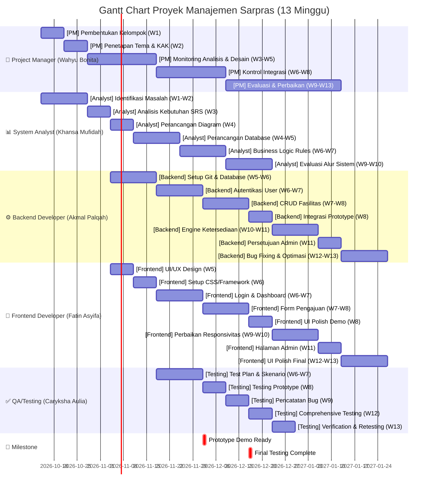

# 📊 Gantt Chart Proyek Manajemen Fasilitas & Laboratorium - 13 Minggu

**Timeline:** Minggu 1 - Minggu 13  
**Last Updated:** 2026-10-10

---

## 📈 Visualisasi Gantt Chart



---

## 📋 Detail Timeline Per Role

### 1. 👤 **Wahyu Bonita Juliana Sari — Project Manager**

| # | Task | Periode | Status | Milestone |
|---|------|---------|--------|-----------|
| 1 | Pembentukan Kelompok & Struktur Tim | W1 | ⏳ Planned | Struktur Tim |
| 2 | Penetapan Tema & Penyusunan KAK | W2 | ⏳ Planned | KAK Document |
| 3 | Monitoring Analisis Kebutuhan & Perancangan | W3-W5 | ⏳ Planned | Design Complete |
| 4 | Kontrol Integrasi Frontend & Backend | W6-W8 | ⏳ Planned | Prototype Demo |
| 5 | Evaluasi Pengerjaan & Perbaikan Sistem | W9-W13 | ⏳ Planned | System Ready |

**Total Duration:** 13 minggu  
**Priority:** HIGH

---

### 2. 📊 **Khansa Mufidah S. — Data Analyst / System Analyst**

| # | Task | Periode | Status | Deliverable |
|---|------|---------|--------|-------------|
| 1 | Identifikasi Masalah & Studi Lapangan | W1-W2 | ⏳ Planned | Problem Statement |
| 2 | Analisis Kebutuhan Pengguna & SRS | W3 | ⏳ Planned | SRS Document |
| 3 | Perancangan Diagram Sistem | W4 | ⏳ Planned | Use Case & Activity Diagram |
| 4 | Perancangan Database & ERD | W4-W5 | ⏳ Planned | ERD Schema |
| 5 | Penyusunan Business Logic Rules | W6-W7 | ⏳ Planned | Business Rules Doc |
| 6 | Evaluasi Alur Sistem vs KAK | W9-W10 | ⏳ Planned | Verification Report |

**Total Duration:** 10 minggu  
**Priority:** HIGH

---

### 3. ⚙️ **Muhammad Akmal Palqah — Programmer Backend**

| # | Task | Periode | Status | Deliverable |
|---|------|---------|--------|-------------|
| 1 | Setup Git, Framework & Database | W5-W6 | ⏳ Planned | Backend Infrastructure |
| 2 | Implementasi Autentikasi User | W6-W7 | ⏳ Planned | Auth API |
| 3 | CRUD Data Fasilitas & Laboratorium | W7-W8 | ⏳ Planned | Facility API |
| 4 | Integrasi Backend untuk Prototype | W8 | ⏳ Planned | Integrated Prototype |
| 5 | Engine Ketersediaan & Pencegahan Bentrok | W10-W11 | ⏳ Planned | Validation Engine |
| 6 | Fitur Persetujuan Admin | W11 | ⏳ Planned | Admin Approval API |
| 7 | Bug Fixing & Optimasi Database | W12-W13 | ⏳ Planned | Production Ready |

**Total Duration:** 9 minggu  
**Priority:** HIGH

---

### 4. 🎨 **Fatin Asyifa Nurrizky JenPutri — Programmer Frontend**

| # | Task | Periode | Status | Deliverable |
|---|------|---------|--------|-------------|
| 1 | Perancangan UI/UX (Wireframe & Mockup) | W5 | ⏳ Planned | Design System |
| 2 | Setup CSS/Framework & Layout | W6 | ⏳ Planned | Frontend Infrastructure |
| 3 | Halaman Login, Dashboard, Catalog | W6-W7 | ⏳ Planned | Core Pages |
| 4 | Halaman Form Pengajuan Peminjaman | W7-W8 | ⏳ Planned | Booking Pages |
| 5 | UI Polish untuk Prototype Demo | W8 | ⏳ Planned | Prototype UI |
| 6 | Perbaikan Responsivitas UI | W9-W10 | ⏳ Planned | Responsive Design |
| 7 | Halaman Jadwal & Admin Panel | W11 | ⏳ Planned | Admin Interface |
| 8 | UI Polish Final | W12-W13 | ⏳ Planned | Production Ready |

**Total Duration:** 9 minggu  
**Priority:** HIGH

---

### 5. ✅ **Caryksha Aulia Putri — Testing / QA**

| # | Task | Periode | Status | Deliverable |
|---|------|---------|--------|-------------|
| 1 | Penyusunan Test Plan & Skenario | W6-W7 | ⏳ Planned | Test Plan Document |
| 2 | Pengujian Prototype untuk Demo | W8 | ⏳ Planned | Test Report |
| 3 | Pencatatan Bug dari Evaluasi | W9 | ⏳ Planned | Bug Report |
| 4 | Pengujian Menyeluruh Seluruh Fitur | W12 | ⏳ Planned | Comprehensive Test Report |
| 5 | Verification Bug Fixing & Retesting | W13 | ⏳ Planned | Final QA Report |

**Total Duration:** 8 minggu  
**Priority:** HIGH

---

## 🎯 **Key Milestones**

| Milestone | Target | Status |
|-----------|--------|--------|
| **W1** | Pembentukan Tim & Jobdesk | ⏳ Planned |
| **W3** | SRS & Requirement Analysis | ⏳ Planned |
| **W5** | Database & Design Finalization | ⏳ Planned |
| **W8** | Prototype Demo Ready | ⏳ Planned |
| **W10** | Schedule Validation Engine | ⏳ Planned |
| **W13** | Final Testing Complete | ⏳ Planned |

---

## 📊 **Timeline Visualization**

```
Week:     W1 | W2 | W3 | W4 | W5 | W6 | W7 | W8 | W9 | W10 | W11 | W12 | W13
─────────────────────────────────────────────────────────────────────────────
PM        ██ | ██ | ████████ | ████████ | ███████████████
Analyst   ██ | ██ | ██ | ██ | ████ | ████ | ████ | - | ████ | - | - | - | -
Backend   - | - | - | - | ████ | ████ | ████ | ██ | - | ████ | ██ | ████ | ██
Frontend  - | - | - | - | ██ | ██ | ████ | ████ | ██ | ████ | ██ | ████ | ██
Testing   - | - | - | - | - | ████ | ██ | ██ | ██ | - | - | ██ | ██

Legend: ██ Active | ████ Medium Activity | ███████ High Activity | - Inactive
```

---

## 🔗 **Links ke Issues di GitHub**

### Parent Issues:
- 👤 [PM - Wahyu Bonita Juliana Sari](https://github.com/Fatinasy7/Manajemen-Sarpras/issues?q=label%3A%22role%3A+PM%22)
- 📊 [Analyst - Khansa Mufidah S.](https://github.com/Fatinasy7/Manajemen-Sarpras/issues?q=label%3A%22role%3A+Analyst%22)
- ⚙️ [Backend - Muhammad Akmal Palqah](https://github.com/Fatinasy7/Manajemen-Sarpras/issues?q=label%3A%22role%3A+Backend%22)
- 🎨 [Frontend - Fatin Asyifa Nurrizky](https://github.com/Fatinasy7/Manajemen-Sarpras/issues?q=label%3A%22role%3A+Frontend%22)
- ✅ [Testing - Caryksha Aulia Putri](https://github.com/Fatinasy7/Manajemen-Sarpras/issues?q=label%3A%22role%3A+Testing%22)

---

## 📝 **Catatan Penting**

1. **Prototype Demo (W8)** adalah milestone penting yang melibatkan semua tim
2. **Testing dimulai dari W6** bersamaan dengan implementasi untuk memastikan kualitas
3. **Bug Fixing & Optimization (W12-W13)** adalah fase finalisasi sebelum production
4. **Koordinasi lintas tim** sangat penting terutama saat integrasi backend-frontend (W6-W8)
5. **QA & Testing** akan terus berlangsung sejalan dengan development (W9-W13)

---

## 📅 **Referensi Kalender**

Asumsi tanggal mulai: **Senin, 14 Oktober 2026**

| Minggu | Periode | Tanggal |
|--------|---------|---------|
| W1 | Setup | 14-20 Okt 2026 |
| W2 | Tema | 21-27 Okt 2026 |
| W3-W5 | Analysis | 28 Okt - 24 Nov 2026 |
| W6-W8 | Implementation | 25 Nov - 22 Des 2026 |
| W9-W10 | Evaluation | 23 Des 2026 - 5 Jan 2027 |
| W11-W13 | Finalization | 6-26 Jan 2027 |

---

**Generated:** 2026-10-10  
**Status:** ⏳ All Tasks Planned  
**Next Milestone:** Week 1 Kickoff
